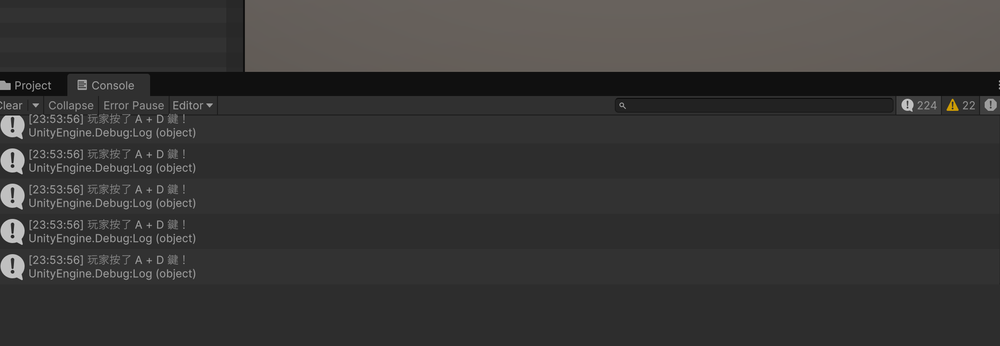
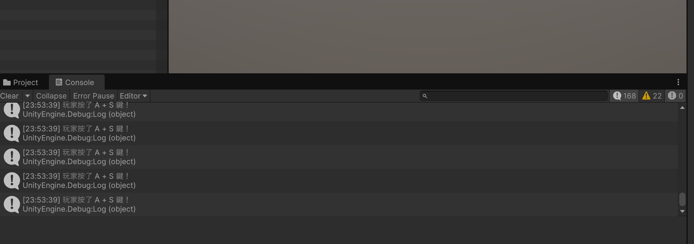
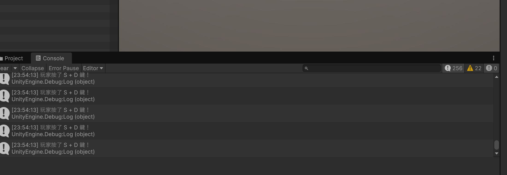
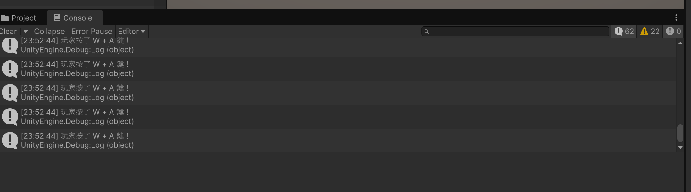
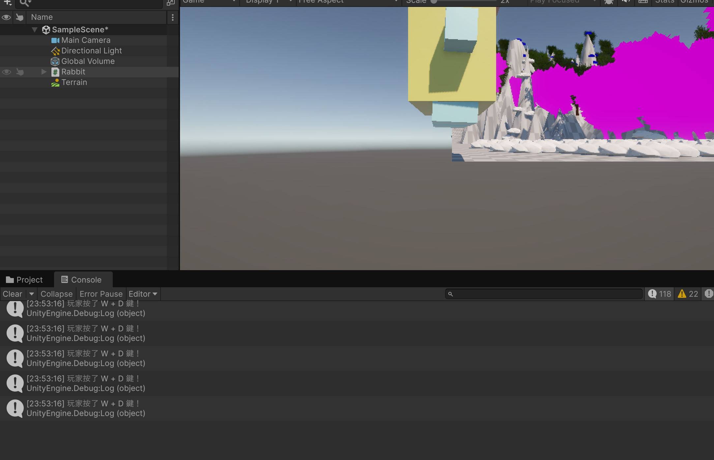
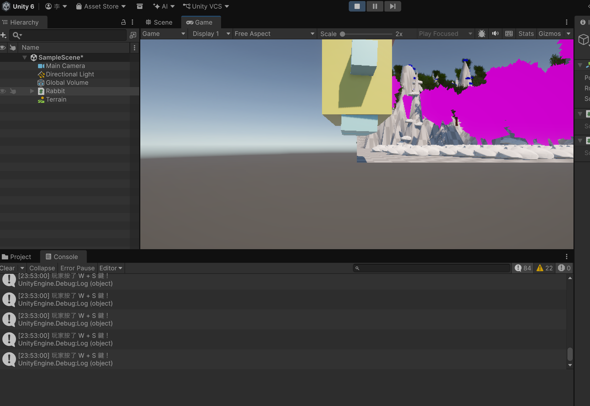

# 第2次作業題目-作業-HW2
>
>學號：113111123
> 
>姓名：李毓倩
> 
>作業撰寫時間：360mins
> 
>最後撰寫文件日期：2026/10/28
>

1. 

   ans:
    ## a. 單鍵偵測 (W / A / S / D)
**程式碼說明：** 用 `Keyboard.current` 取得鍵盤，
`wasPressedThisFrame` 偵測按下瞬間，並用 `Debug.Log` 印出。

（if (keyboard.wKey.wasPressedThisFrame)
{
    Debug.Log("玩家按了 W 鍵！");
}

if (keyboard.aKey.wasPressedThisFrame)
{
    Debug.Log("玩家按了 A 鍵！");
}

if (keyboard.sKey.wasPressedThisFrame)
{
    Debug.Log("玩家按了 S 鍵！");
}

if (keyboard.dKey.wasPressedThisFrame)
{
    Debug.Log("玩家按了 D 鍵！");
}
）

**執行結果：**

在 RabbitController.cs 的 Update() 方法中，使用 Keyboard.current 取得鍵盤裝置，並透過 wasPressedThisFrame 判斷按鍵是否在目前影格剛被按下。

    b. 雙鍵複合鍵
**程式碼說明：** 用 `isPressed` 判斷兩鍵是否同時按住，
先判斷複合鍵，符合就 `return`，避免重複印出單鍵訊息。

（using UnityEngine;
using UnityEngine.InputSystem;

public class RabbitController : MonoBehaviour
{
    void Update()
    {
        Keyboard keyboard = Keyboard.current;

        if (keyboard == null)
        {
            return;
        }

        if (keyboard.wKey.isPressed && keyboard.aKey.isPressed)
        {
            Debug.Log("玩家按了 W + A 鍵！");
        }if (keyboard.wKey.isPressed && keyboard.sKey.isPressed)
    {
        Debug.Log("玩家按了 W + S 鍵！");
    }

    if (keyboard.wKey.isPressed && keyboard.dKey.isPressed)
    {
        Debug.Log("玩家按了 W + D 鍵！");
    }

    if (keyboard.aKey.isPressed && keyboard.sKey.isPressed)
    {
        Debug.Log("玩家按了 A + S 鍵！");
    }

    if (keyboard.aKey.isPressed && keyboard.dKey.isPressed)
    {
        Debug.Log("玩家按了 A + D 鍵！");
    }

    if (keyboard.sKey.isPressed && keyboard.dKey.isPressed)
    {
        Debug.Log("玩家按了 S + D 鍵！");
    }
}
    }
）

**執行結果：**

## 其他:就算做了蠻多次作業還是很麻煩每次下在檔案版本都有因為不同打不開一直要重新下載檔案的麻煩

